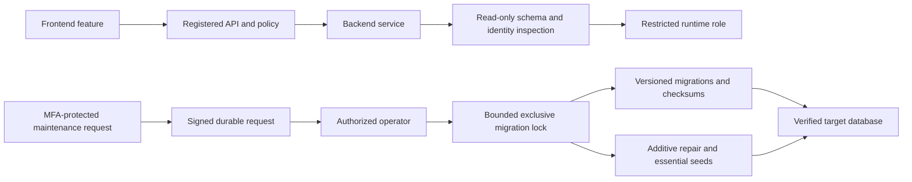

# Database recovery and fresh installation

The portal reconstructs its schema from the existing numbered PostgreSQL migrations. Ordinary HTTP requests perform read-only inspection; they never create tables or run migrations. Use the operator workflow below with separate migration credentials. This document supersedes earlier reports that described the replacement database as empty or Preview as unconfigured.

## Connect, inspect, recover

Keep bootstrap credentials in ignored `.env.development.local` or a deployment secret store. `DATABASE_URL` is the runtime Session pooler URL; `DIRECT_DATABASE_URL` is the separate migration connection. Both use TLS. Vercel requires Session pooling on port 5432 because the application uses session advisory locks. The connection username/project reference must match `SUPABASE_PROJECT_REF` before an operator command can run.

```powershell
npm run db:discover
npm run db:status
npm run db:recover -- --confirm-ref YOUR_PROJECT_REFERENCE
npm run db:recover -- --apply --confirm-ref YOUR_PROJECT_REFERENCE
npm run db:validate
npm run infrastructure:verify -- --apply --confirm-ref YOUR_PROJECT_REFERENCE
npm run dev
```

The first recovery command is a dry run. The applied workflow inspects the target, runs authorized pending migrations, repairs safe missing objects, restores essential defaults, preserves or establishes encryption/signing material, provisions a restricted runtime role, queues approved knowledge-source rebuilds, rebuilds existing search indexes, and validates the result. A populated database with pending versioned changes additionally requires `--allow-reviewed-migrations`. Changed/unknown checksums and unreviewed schema drift stop recovery.

The protected previous production project is refused for writes unless an operator deliberately supplies its separate authorization flag. No destructive reset exists in this workflow. Before applying changes to an existing database, capture a verified backup and review the plan. Do not change the old database while preparing its replacement.

For the first administrator only:

```powershell
npm run db:admin -- --apply --confirm-ref YOUR_PROJECT_REFERENCE --confirm-first-admin --name "Authorized Administrator" --email "administrator@example.org"
```

The command generates a strong password, MFA enrollment URI and recovery codes in the ignored `data/first-administrator-setup.json`. Enroll the authenticator, sign in, replace the password, and secure/remove that file. Existing administrators and the durable setup marker both prevent duplicate provisioning. There is no public administrator-creation endpoint. The same first-time arguments can be supplied to `db:recover` on a verified fresh installation.

## Architecture and safeguards



`database/system-inventory.json` maps discovered frontend API references, handlers, imported backend modules, SQL references, environment dependencies, workers and migrations. Discovery uses the JavaScript AST and transitive imports rather than a fixed handler/table count. Runtime-computed SQL, conditional dispatch and nonliteral URLs still need execution tests; static discovery does not prove a successful business workflow.

`database/schema-manifest.json` captures the actual catalog after a verified zero-table migration run. Its migration digest prevents an arbitrary live database from becoming the trusted reference. The operator compares tables, columns, constraints, indexes, functions, triggers, views, sequences, enums, extensions, RLS policies and public grants. Extra restricted runtime-role policies are expected; missing RLS/backend access and unexpected public exposure are findings. Reference regeneration is allowed only in a separate verified fresh test database after reviewed migration changes.

Each migration is transactional and journaled after success. Earlier completed migrations survive a later failure, and matching interrupted fresh runs can resume. A bounded advisory lock serializes operators. Repairs are transactional and validated before commit. Existing definitions requiring changes are preserved for a reviewed migration. Missing sequences or identity state require a verified source instead of guessing historic reference numbers. Generated expressions are reconstructed from the trusted catalog.

Essential settings come from the complete nonsecret settings definitions; roles/permissions use the existing authorization definitions. Approved configuration, AI and reference seeds are read from their original migrations. Inserts preserve existing keys and edited values. Historical resident/staff accounts, applications, transactions, audit records and uploaded-file relationships are never synthesized. Optional credential decryption failures are isolated to that setting and reported; ciphertext is retained.

Changing the connection requires the operator recovery workflow and a process restart/redeployment. The local runner watches environment changes and refreshes file-loaded settings. Runtime inspection verifies the configured project and durable database identity. Redis keys include environment/branch and database identity, so a replacement database cannot reuse the previous installation's sessions, verification tokens or cached data. No Redis instance flush is performed.

## Admin maintenance

Settings → Supabase Database displays live schema state, identity, object counts, migration status, missing records and the latest operation. Inspection, connection testing, validation and redacted report export are read-only.

Repair, migration, seeding, derived-data rebuild and Azure reconciliation requests require database-management permission, CSRF protection, explicit confirmation and a current MFA code. The API records a signed request; an operator runs the displayed `db:execute-job` command with migration credentials. Signatures bind the actor, target identity, action, timestamp and nonce. Expired/tampered/duplicate requests cannot execute. Schema writes never run inside the request.

## Historical backup and restoration

```powershell
npm run db:restore-plan
npm run db:backup
# For a previous source, supply SOURCE_DATABASE_URL securely first:
npm run db:restore-plan -- --source --source-ref SOURCE_PROJECT
npm run db:backup -- --source --source-ref SOURCE_PROJECT
npm run db:restore -- --file data/backups/VERIFIED_BACKUP.gbak --source-ref SOURCE_PROJECT --apply --confirm-ref TARGET_PROJECT
```

Backups stream every discovered public table, dependency groups, exact row payloads, table counts/checksums and sequence state into AES-256-GCM encrypted files under ignored `data/backups`. Preserve `GETAFE_BACKUP_KEY` or the generated private `data/.database-backup-key` separately and securely. Losing this key loses access to these backups. Supabase-managed/native PostgreSQL backups retain their own provider restore workflow; `.gbak` is the application's separate logical format.

Restoration authenticates the complete ciphertext before any database write. It verifies source/destination identities and schema compatibility, preserves UUIDs/keys, orders strongly connected foreign-key groups, and commits each group only after constraints validate. Failed groups roll back; previously committed groups can be resumed with exact-record duplicate verification. Sequence values only advance to the verified maximum of source/destination state.

Default conflicts abort the current group. After reviewing the conflict inventory, `--conflicts preserve-destination` keeps edited target rows and reports partial recovery instead of claiming exact success. Target identity, migration/operation journals, initial-admin marker and transient authentication/OAuth state are explicitly inventoried and retained, with reasons. They are not silently omitted from the backup.

Encrypted settings, MFA enrollments and integration credentials must authenticate with the original key material. Supply the appropriate `SOURCE_SETTINGS_ENCRYPTION_KEY`, `SOURCE_MFA_ENCRYPTION_KEY`/`SOURCE_AUTH_SESSION_SECRET`, or `SOURCE_INTEGRATION_VAULT_KEYS`/`SOURCE_INTEGRATION_VAULT_VERSION` securely. The restore re-encrypts verified values for the destination; missing source keys stop the affected group. Unknown external secret references require their original secret-store recovery workflow.

Restored background work remains paused, including email, integration claims, AI indexing and notification outboxes. Review providers, identities, idempotency/delivery records and the completed restore before authorizing:

```powershell
npm run db:approve-restored-jobs -- --apply --confirm-ref TARGET_PROJECT --confirm-reviewed-deliveries
```

There is no destructive automatic rollback of already committed historical groups. Before a restore, back up the destination. If recovery must be abandoned, retain evidence and restore the verified pre-operation backup into another isolated target; never delete historical rows merely to retry.

## Azure, Redis and optional services

`infrastructure:verify` checks TLS Redis PING and its own short-lived namespaced SET/GET/DEL. For this new installation it creates/verifies a separate private, installation-owned Azure container and tests an owned random blob with upload/read/delete. It never changes the original media container's public-access setting or deletes its objects. Use this provisioning command for a fresh isolated installation, not as an unreviewed storage cutover for an existing populated site.

`db:reconcile` inventories Azure containers/blobs/metadata and compares available database file/URL/JSON references. The private report stays in `data/recovery`. Unmatched private blobs are not enough to infer ownership, captions, permissions or content relationships; use historical database records/metadata and explicit import authorization. Encrypted/indirect/HTML-only references may require module-specific historical evidence.

Native Vercel Marketplace variables can provision the bootstrap connection through account authorization. The app still needs its initial trusted database connection and stable encryption/signing keys; an authenticated settings screen cannot discover those secrets before it can authenticate. Optional providers can subsequently be configured in admin settings or the provider's authorized integration.

Vercel runtime needs `NODE_OPTIONS=--experimental-require-module` for the current `sanitize-html` → ESM `htmlparser2` dependency. This is configured in `vercel.json` and the isolated Preview environment, following [Vercel's Node configuration documentation](https://vercel.com/docs/functions/runtimes/node-js/advanced-node-configuration). Keep the current sanitizer security fixes. The production import smoke test uses the same setting.

Persistent managed workers remain separate from Vercel Functions; see [BACKGROUND_JOBS.md](BACKGROUND_JOBS.md). Enabling SMTP, OAuth, payment, CAPTCHA or AI features requires real provider credentials/authorization. Missing providers must report their actual disabled/unavailable state, while independent public reads remain usable.

## Verification and release

```powershell
npm run lint
npm test
npm run test:production
npm run verify:deployment
npm run db:validate
```

Live recovery tests require their explicit isolated-target guard. The API harness binds only loopback and isolates its own Redis namespace; only its global traffic limiter is replaced for the high-volume route sweep. Authentication, MFA, CSRF, authorization and database operations remain real. A separate normal-rate sweep exercises actual rate limiting. Empty-body/nil-resource boundary probes do not prove successful billing, payments, resident verification or every administrative mutation.

See [DATABASE_RECOVERY_REPORT.md](DATABASE_RECOVERY_REPORT.md) for measured results, remaining external blockers and deployment provenance. Production promotion remains a separate authorized release action.
