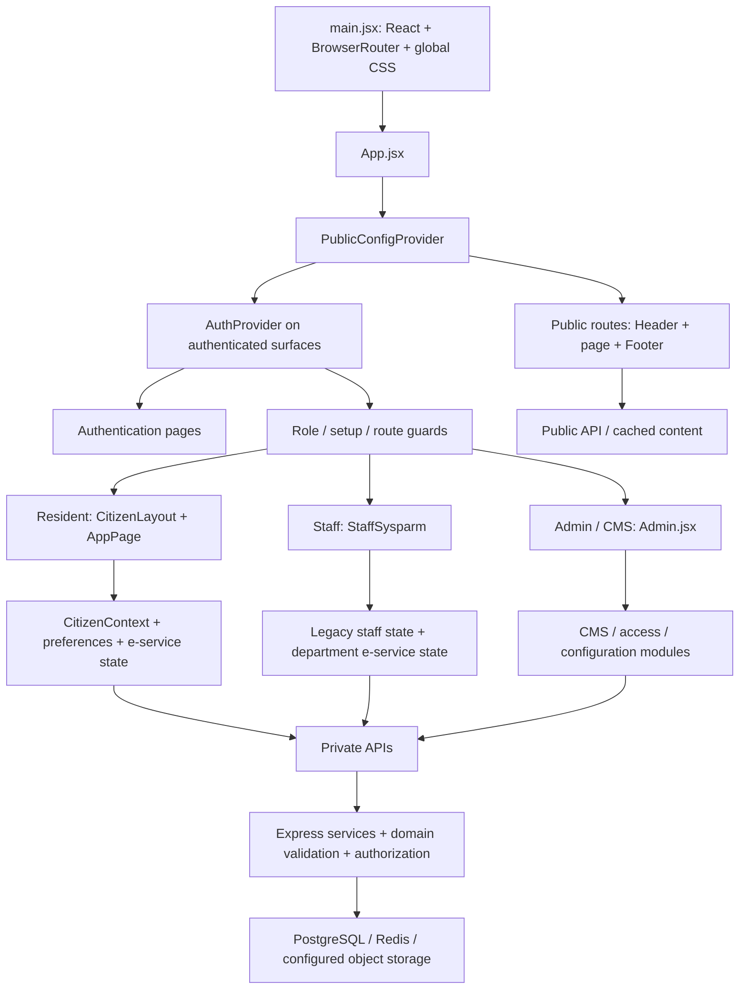
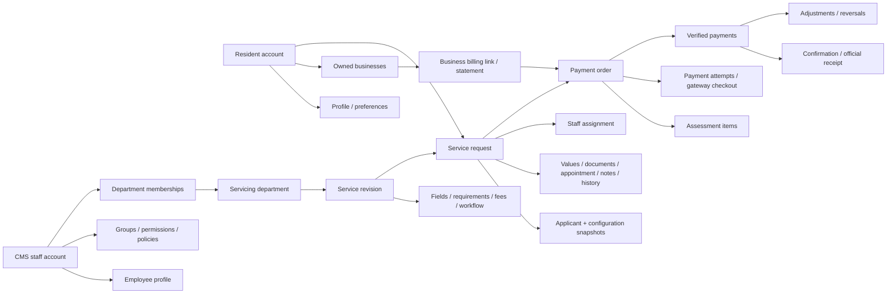

# Getafe Portal — application and UI blueprint

Snapshot: **4 October 2026, Asia/Manila**. This describes the current local working tree, including recent UI fixes. It is a source-based blueprint for a UI overhaul, not an exact physical database schema or a claim that every screen has been visually verified.

## How to give this to another AI

Supply this document, `UI_BLUEPRINT.json`, `UI_ROUTE_INVENTORY.md`, and `UI_OVERHAUL_PROMPT.md`. If the AI can access the repository, also give it the source files named here. Without source access, it should propose a design and audit plan rather than invent code-level defects or missing functionality.

- **This document:** architecture, screen patterns, workflows, invariants and overhaul plan.
- **UI_BLUEPRINT.json:** machine-readable surfaces, full route inventory, permission module registry, default workflows, semantic tokens, component families, source imports and stylesheet metrics.
- **UI_ROUTE_INVENTORY.md:** exhaustive generated route/view ownership and compatibility redirects.
- **UI_OVERHAUL_PROMPT.md:** ready-to-use review and redesign instructions.

Regenerate the source inventory with `node scripts/export-ui-blueprint.mjs`. The narrative blueprint and handoff prompt are curated separately. The JSON is structured architecture data, not a JSON Schema validator specification.

## 1. Application topology



**Stack:** React 18, JSX, Vite, React Router, predominantly plain CSS, lucide-react icons, Express services, PostgreSQL, Redis infrastructure and configured object storage. Leaflet is used through the map component. Utility-style class strings exist in `components/ui`, but their presence alone does not establish an active Tailwind build.

**Routing has three cooperating sources:**

| Source | Responsibility |
| --- | --- |
| `src/routes.js` + `src/routeConfig.js` | Discover page files, assign route overrides, lazy-load pages, manage legacy redirects |
| `src/App.jsx` | App entry, staff/admin explicit routes, authentication and role guards, setup gate, error/maintenance/offline boundaries |
| `src/routeRegistry.js` + `src/applicationModuleRegistry.js` | Canonical shell modules, permissions, query ownership, settings category slugs and compatibility mapping |

Adding or renaming a page file can affect routing. A sidebar label is not sufficient evidence that a dedicated page exists. Several staff registry concepts such as reports/appointments/document processing share the staff root path; review the shell's actual rendered modules before proposing new destinations.

## 2. Five UI surfaces

| Surface | Shell and layout | Typical screen pattern | Data/access boundary |
| --- | --- | --- | --- |
| Public website | `Header`, `Footer`, public page bodies | Editorial sections, catalog, directory, article, map, public data | Anonymous browsing; public configuration/content APIs |
| Authentication | `Login`, `ForgotPassword` | Sign-in/register modes, verification challenges, password recovery | AuthContext; safe return navigation; no public header/footer |
| Resident portal | `CitizenLayout`, `AppPage` | Sidebar/topbar, dashboard, list/detail, forms, account overlays | Resident role, account setup, private record ownership |
| Staff portal | `StaffSysparm` | Permission-filtered sidebar/topbar, queue, record detail, processing panel | Staff-compatible role, module permissions, department membership, operation permissions |
| Admin/CMS | `Admin.jsx` | CMS navigation, tables, editors, media selectors, access/configuration dialogs | Admin-compatible role and effective module/action permissions |

The global public header/footer are suppressed for `/auth/*`, `/admin/*`, and the `/app` family. Admin imports some citizen styling; these are different shells despite CSS reuse. Resident preference provisioning exists around the `/app` family, but do not assume all staff components consume every preference.

Public browsing intentionally does not initialize authenticated account context. An overhaul must preserve that separation.

## 3. Functional page inventory by product area

The exact URLs and source files are in `UI_ROUTE_INVENTORY.md`; this is the product-oriented grouping.

| Area | Existing responsibilities | Main source owners |
| --- | --- | --- |
| Municipal public information | About/history/seal/hymn, contact, accessibility, sitemap, legal | `src/pages/info`, `src/pages/legal` |
| Public service discovery | Service catalog, configurable e-service detail, service guides, office directory, hotlines | `src/pages/services`, `ServiceCatalog`, `ServiceDetails`, `ServicePageLayout` |
| Directories | Departments, officials, barangays and related profiles | `src/pages/departments`, public officials/barangay pages |
| News/events/discovery | News articles, event detail, destinations, tourism | `src/pages/news`, `events`, `discover`, `tourism`; article/gallery components |
| Public datasets/weather | Dataset explorer/detail, barangay statistics, weather charts | `src/pages/data`, `src/pages/weather`, public-data/map services |
| Resident dashboard/account | Summary, profile/setup/settings, businesses, support/notifications | `Dashboard`, `CitizenLayout`, `Profile`, `Setup`, `Settings`, `Help`, `Notifications` |
| Legacy resident applications | Application list/detail and document request flow | `Requests`, `Application`, `RequestDocument`, `CitizenActions` |
| Configurable resident e-services | Service detail, drafts, multi-step submission, tracking | `Eservice`, `Erequests`, `Erequest`, `DynamicApplication`, `EserviceUI` |
| Appointments/documents | Availability-based booking, document library/upload/view | `Appointments`, `AppointmentFields`, `Documents` |
| Payments/billing | Legacy payment/settlement views, e-billing lists, orders, business billing | `Payments`, `Ebilling`, `Epayment`, `BusinessBillingPanel` |
| Staff legacy operations | Dashboard, request search/pagination, document upload and fulfillment dialogs | `StaffSysparm`, `StaffRequestModal`, `FulfillmentNoteModal` |
| Staff department operations | Incoming queue, assignment, review, documents, assessments, payments, history | `StaffEservices`, `StaffRequestProcessing`, `StaffAssessment`, `StaffBillingOperations` |
| CMS publishing | News/event editor, categories, directory/destination content, media library | `Admin.jsx`, `AdminDepartments`, `AdminDestinations` |
| Service configuration | Fields, requirements, fees, workflows, payments, notifications, publishing | `AdminEservices` |
| Identity/access | Employee provisioning/profile, groups, permissions, policies, effective access, audit | `AdminAccessManagement`, `EmployeeProfile`, `EmployeeSelect`, `StaffDepartmentAccess` |
| Operational administration | System settings, privacy requests, Error Center and audit | `AdminSettings`, `AdminPrivacyRequests`, `AdminErrorLogs`, admin shell |

### Parallel systems that require deliberate treatment

1. `/app/requests` (**My Applications**) and `/app/e-requests` (**My Requests**) are distinct routes and data flows. The resident sidebar currently exposes both.
2. `/app/staff/requests` is the legacy processing surface; `/app/staff/e-requests` is the department e-service queue.
3. Legacy `/app/payments` coexists with `/app/e-billing/:kind` and `/app/e-payment/:id`.

These are source-confirmed architectural differences, not proof that one can be deleted. A redesign can unify navigation and visual patterns, but must map data, status, ownership and financial contracts before consolidating features.

## 4. Shared components and ownership

| Family | Current building blocks | Standardization objective |
| --- | --- | --- |
| Shells | Public Header/Footer, CitizenLayout, StaffSysparm, Admin.jsx | Consistent spacing and utility behavior; preserve different audience navigation |
| Feedback and recovery | RouteStatusPages, Feedback, maintenance/offline/configuration states | Shared loading/empty/error/retry/success hierarchy |
| E-service patterns | DynamicFields, RequestTable, Activity, OrderView, DynamicApplication | Shared field, status, table, detail and history presentation |
| Appointment fields | AppointmentFields shared by configurable and legacy booking | Keep availability, contact validation and calendar behavior while restyling |
| Staff detail | StaffRequestProcessing, StaffAssessment, StaffRequestDetail.css | Keep read-only information separate from authorized operations |
| Employee forms | EmployeeProfile, EmployeeSelect | Preserve account/personnel draft independence and configured dropdown choices |
| Modals/overlays | ModalDialog, ProfileModal, PasswordChangeModal, ImportantAnnouncement, ImageLightbox, specialized CMS overlays | Standardize focus, dismissal, scroll ownership, stacking and sizing by purpose |
| Public content | Hero, article/gallery, services/news/events/discovery components | Shared section/container/media patterns |
| Utilities | StableAvatar, BackToTop, narration controls, weather/header utilities | Shared accessibility and icon-control rules |

`src/components/ui` currently contains a small Card/SectionContainer family. It is not a complete universal button/form/dialog/table library. Much of the current design system is distributed across feature components and CSS files.

Full JSX/CSS source ownership and local imports are included in the JSON inventory. Import relationships are source references, not proof that every exported component is currently mounted.

## 5. Current styling architecture

**Global starting point:** `src/main.jsx` imports `src/index.css`, which imports `src/focus.css` and `src/icon-buttons.css`. Lazy pages/components import additional global stylesheets. These are not CSS Modules; selector names can interact across surfaces.

| Style layer | Responsibility / risk |
| --- | --- |
| `src/index.css` | Root tokens, public/auth/CMS styles and accumulated shared rules; large global scope |
| `src/citizen.css` | Resident shell, widgets, forms, account/settings and theme overrides; also imported by admin |
| Staff CSS files | Staff shell/header/legacy dialogs; independent responsive rules |
| `EserviceUI.css` | Shared resident/staff/admin e-service styles, green button accent, form/table/detail patterns |
| `StaffRequestDetail.css` | Scoped request detail layout and navy selected navigation |
| Admin component CSS | Access/settings/service-editor/media/directory patterns |
| Public page/component CSS | Content-specific layouts, dataset styling, announcements and galleries |

### Existing root color tokens

| Token | Value / role |
| --- | --- |
| `--navy-950` | `#071A33` |
| `--navy-900` | `#0B2345` |
| `--navy-800` | `#12345B` |
| `--navy-700` | `#194A78`; aliased by `--primary` |
| `--navy-600` | `#24639A` |
| `--blue-500` | `#2F80C9`; focus color |
| `--surface` | `#FFFFFF` |
| `--surface-muted` | `#F6F8FB` |
| `--border` | `#D9E2EC` |
| `--text-primary` | `#17233A` |
| `--text-secondary` | `#5F6B7A` |

Other root aliases, z-index tokens and input colors are exported in the JSON. Stylesheet metrics and media queries are also exported.

**Cascade caveat:** citizen.css contains earlier visual directions followed by later navy/token and theme overrides. Do not treat an earlier cream/teal declaration as the active final appearance without checking computed styles. Likewise, source z-index tokens coexist with specialized overlay values.

### Interaction rules already established

- Explicit ghost icon controls use `data-icon-button="ghost"`, remain transparent on hover/active/focus, and retain at least a 44px invisible hit target.
- Text CTAs retain their intentional backgrounds; icon-only policy must not strip Save/Submit/Pay buttons.
- Keyboard `:focus-visible` uses a 2px `--focus-ring` outline with 2px offset.
- Theme/contrast/preference attributes and reduced-motion behavior must be preserved.
- Dialogs, menus and drawers require accessible names, keyboard operation, focus return and appropriate background isolation.

## 6. UI-facing data schema

This is a conceptual domain model. It intentionally omits column types, indexes and physical database migration details.



**Important distinctions for the redesign:**

- Employee profile **Department** text and operational **servicing department memberships** are different concepts.
- A staff role does not imply assessment/payment rights. Groups, effective permissions and department access determine actions.
- A draft, submitted request, assessment, payment attempt, verified payment and official receipt are separate records/states.
- Business ownership and applicant identity are server-bound; the UI must not let a user relabel ownership to gain access.
- Existing requests use configuration snapshots/revisions. New CMS fee/field changes must not silently rewrite prior assessments or application definitions.
- News/event/category/media/directory/destination records form the public content graph. Media usage references and public/private access remain significant during visual redesign.

## 7. User flow contracts

### Resident application

Service discovery → service detail → authentication/setup if needed → create/resume draft → applicant information → requirements/documents → configured field sections → appointment when required → review/declaration → submit → department queue → resident tracking/corrections.

DynamicApplication builds sections from configuration. Do not hard-code one universal municipal form. Preserve draft saving, declaration, upload/replacement state, optimistic version checks, and appointment availability/conflict recovery.

### Staff processing

Department incoming queue → review record → assignment if permitted → document review/correction → configured status transition → assessment/payment when required → approval/release or business-billing completion → activity/audit.

The incoming queue defaults to submitted requests, oldest first, and refreshes periodically while visible. Detail forms are not periodically refreshed in a way that erases drafts. Staff dashboards may redirect department-only staff to the e-service queue rather than a legacy dashboard they cannot read.

### Default application workflow

```text
DRAFT → SUBMITTED → RECEIVED / IN_REVIEW
IN_REVIEW → FOR_ASSESSMENT or FOR_APPROVAL
FOR_ASSESSMENT → AWAITING_PAYMENT → PAID
PAID → FOR_APPROVAL → APPROVED → FOR_RELEASE → COMPLETED
```

Correction, rejection, cancellation and permitted alternative branches are defined in the exported transition arrays. The sequence above is illustrative, not a universal state machine.

### Business billing workflow

Business/statement or assessment selection → staff review/assessment → applicant assessment review → payment method/submission or checkout → pending verification → verified payment → required official receipt → completed transaction.

The starting billing workflow is different from the general application workflow. It can complete after verified payment/required receipts without the general approval/release stages. `businessBillingWorkflow.js` also defines information/application/appointment/assessment/payment workflow types. Published service revisions can vary these transitions.

Resident-facing status labels intentionally summarize internal processing stages: for example, FOR_ASSESSMENT and several approval stages may display as Processing, while AWAITING_PAYMENT may display as Payment Required. Billing can separately display Pending payment verification. The exact resident mappings are exported in the JSON. Legacy lowercase application statuses are a different contract; do not assume case normalization alone makes the systems equivalent.

**Financial operations must remain distinct:** issue/replace assessment, record payment submission, verify payment, record official receipt, adjust/reverse payment, complete request. A status dropdown must not bypass these operations or manufacture financial state.

### Employee provisioning and profile

Create employee → required identity/department/position → required permission groups → required servicing offices when department access is granted → atomic provisioning → profile/personnel/account editing → effective-access review.

Department/office/employment type/employment status use configured or stored dropdown choices. Position/name/email/phone remain appropriate text controls; hire date remains a date control; groups/offices support multiple selections where required. Existing historical values must remain visible. Saving one profile section must preserve unsaved edits in the other.

## 8. Source-confirmed inconsistency candidates

These are architecture/design review targets. Their presence is confirmed in source; severity and final design choices need product/runtime review.

| Candidate | Why review it | Evidence |
| --- | --- | --- |
| Dual request navigation | My Applications vs My Requests may confuse residents | CitizenLayout, Requests, Erequests |
| Dual payment experiences | Legacy payments, e-billing and orders need coherent terms and entry points | Payments, Ebilling, Epayment |
| Global CSS accumulation | Repeated historical blocks and shared selectors make overrides fragile | index.css, citizen.css |
| Token bypass and accent variation | Literal colors/radii/borders coexist with root tokens; green e-service CTAs and navy section selection need intentional semantic roles | EserviceUI.css, StaffRequestDetail.css, admin CSS |
| Overlay families | Specialized overlays may differ in sizing, scrolling, dismissal and focus behavior | ModalDialog, ProfileModal, ImportantAnnouncement, CMS overlays |
| Responsive breakpoint variation | Sidebars/tables/forms/settings switch layout at different widths | Resident/staff/admin/component CSS |
| Section-navigation semantics | role=tab, aria-current and aria-pressed patterns need intentional use and consistent keyboard behavior | AdminAccessManagement, AdminSettings, Erequest, AdminEservices |
| Distributed primitive ownership | Existing ui directory does not cover most feature controls | components/ui, CitizenWidgets, EserviceUI |
| Different source naming from URL naming | `dashboard` sources power resident pages; staff/admin shells own many virtual views | routeConfig, routeRegistry, App.jsx |

Do not report every difference as a defect. Public editorial pages and staff transactional pages need different density; destructive actions and positive status indicators legitimately use semantic colors.

## 9. Proposed overhaul structure

This is a recommendation, not a description of already implemented folders.

```text
design-system/
  tokens/              semantic color, type, spacing, radius, elevation, motion, layers
  primitives/          buttons, icon buttons, fields, checkbox, select, dialog, drawer
  navigation/          sidebar, topbar, menus, tabs, breadcrumbs
  feedback/            loading, empty, error/retry, success, conflict, status badges
  data-display/        tables, metadata grids, timelines, document/payment rows
  patterns/            page header, filters/pagination, form sections, processing panel
shells/                 public, authentication, resident, staff, admin
features/               content, services, requests, appointments, billing, employees, settings
adapters/               existing API and state contracts
```

Recommended order:

1. Inventory and classify all screens, states and ownership before editing.
2. Agree on semantic tokens, typography, spacing, accessibility and responsive rules.
3. Build primitives with complete states and representative examples.
4. Migrate shared shells and navigation.
5. Migrate lists, record details and form patterns.
6. Migrate transactional application/assessment/payment flows using unchanged contracts.
7. Migrate specialized CMS/settings/media/public pages.
8. Remove obsolete CSS only after proving which consumers migrated.

## 10. Review and acceptance schema

For each finding, ask the redesign AI to output:

```json
{
  "id": "UI-001",
  "surface": "staff",
  "route": "/app/staff/e-requests/:id",
  "state": "under-review",
  "viewport": "390px",
  "component": "StaffRequestProcessing",
  "source_files": ["src/components/StaffRequestProcessing.jsx"],
  "category": "layout | typography | color | navigation | form | feedback | accessibility | consistency",
  "severity": "blocker | major | minor | polish",
  "evidence_type": "runtime-reproduced | source-confirmed | hypothesis",
  "evidence": "Concrete observed behavior or source reference",
  "user_impact": "Effect on the user's task",
  "proposed_fix": "Specific change using shared patterns where possible",
  "shared_component_change": true,
  "behavior_to_preserve": ["department permissions", "draft preservation"],
  "verification": ["keyboard", "mobile", "desktop", "error/retry"]
}
```

Evaluate at least 320, 390, 768, 1024 and 1440px; keyboard and touch; light/dark/high contrast/reduced motion where supported; empty/long/loaded/error/busy/conflict states; and each permission-relevant persona. Use content-dependent wrapping rather than truncating essential identity/reference/amount information.

**Existing evidence:** `docs/APP_AUDIT.md`, browser scripts listed in the JSON, and `artifacts/*` screenshots. Some tests use fixtures; domain billing tests use isolated test data. Existing passes cover those cases, not all live CMS content or every theme combination.

**Overhaul boundaries:** preserve canonical and legacy URLs, anonymous/authenticated separation, setup/access gates, ownership/department checks, configured service snapshots, financial integrity, document privacy, focus/hit targets, unsaved-input recovery and Philippine time handling. Treat backend behavior changes as separate work that requires evidence and explicit scope.
